### Jeff Lemons · The IT Guy
**Systems & DevOps engineer. I build self-hosted infrastructure, monitoring and business tooling that stays out of your way.**

---

### About

I run **The IT Guy** out of New Braunfels, TX: web builds, tech support, consulting and custom monitoring for small businesses. Most of what I ship is the kind of thing a small shop normally rents from a SaaS vendor, built instead to run on hardware the customer owns, with no telemetry and no lock-in.

I work Linux-first, script everything I do twice, and use AI coding tools (Claude, ChatGPT, Gemini) from the terminal as part of a normal review-and-test workflow. They draft; I architect, verify and own what gets deployed.

---

### Featured work

| Project | What it is | Stack |
|---|---|---|
| **SentinelRMM** | Multi-tenant remote monitoring & management platform with live fleet streaming, browser-based remote desktop and built-in billing. v1.0.1 shipped. | FastAPI · PostgreSQL · React · Python agent · WebSockets · Guacamole · Docker Compose |
| **Nexivo NOC** | Native Android network-operations dashboard for my self-hosted stack. Real-time status over WebSockets, locked behind a WireGuard VPN gate. | Kotlin · Jetpack Compose · MVVM/StateFlow · Retrofit · OkHttp · WireGuard |
| **BidHub** | Bidding and CRM platform for IT, AV and CCTV jobs, being productized as a self-hosted, license-keyed product for trades (HVAC, electrical, locksmiths). | Python · PostgreSQL · n8n · license server |
| **Windows Debloat Toolkit** | PowerShell framework that strips telemetry and bloat and tunes Windows for performance. | PowerShell |
| **Silhouette OS** | Minimal, security-hardened Linux distribution. *(in development)* | Linux · Bash |
| **GroceryCompare** | Android price-comparison app for everyday shopping. *(in development)* | Kotlin · Jetpack Compose |

---

### Toolbox

**Languages**
 

**Backend & frontend**
 

**Infrastructure & security**
 

**Daily drivers**
 

---

### Work with me

I take on consulting for small businesses that want private, self-hosted infrastructure: monitoring, hardening, migrations off rented SaaS, and custom internal tools. I'm also open to full-time systems, DevOps and infrastructure roles.

